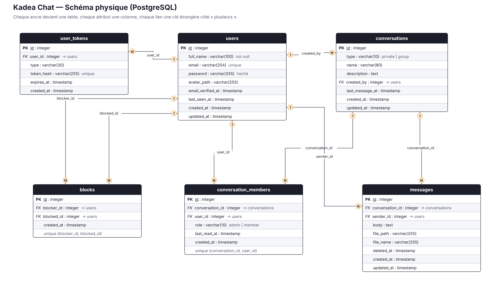
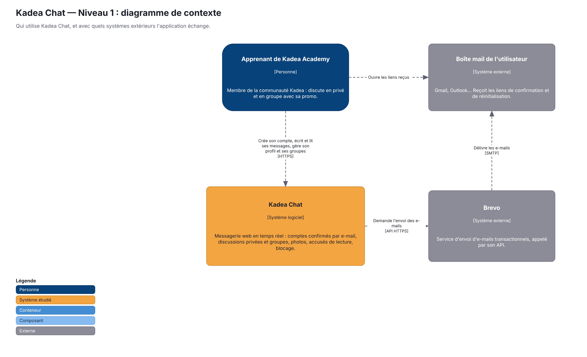
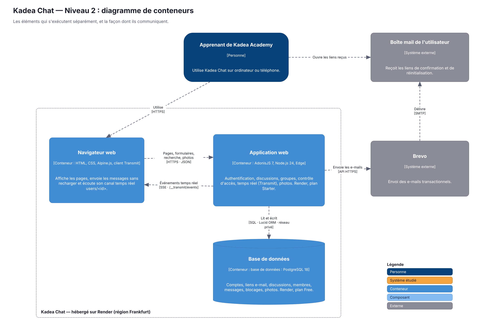
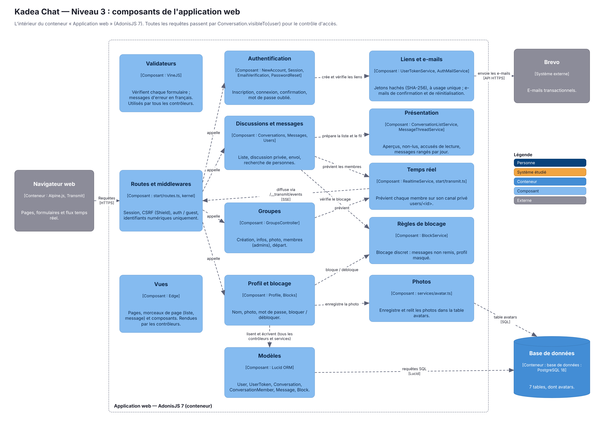

# Kadea Chat

Messagerie web en temps réel, avec conversations privées et groupes. C'est le projet capstone de la formation Kadea Academy.

**Application en ligne : https://kadea-chat-qb7r.onrender.com**

> L'application est hébergée sur Render. La base de données en ligne est distincte de la base locale : pour tester, crée un compte directement sur le site et confirme ton e-mail. Pour discuter avec toi-même, ouvre un second compte dans une fenêtre de navigation privée.

---

## Fonctionnalités

### Comptes et sécurité
- Inscription avec **confirmation de l'adresse e-mail** : un lien est envoyé par Brevo, et la connexion est refusée tant que l'adresse n'est pas confirmée.
- Connexion, déconnexion et **mot de passe oublié**, avec un lien de réinitialisation valable 15 minutes.
- Mots de passe hachés (scrypt), protection CSRF sur tous les formulaires, messages d'erreur volontairement vagues à la connexion.
- **Contrôle d'accès** : une personne ne voit et n'écrit que dans les conversations dont elle est membre. Pour les autres, le serveur répond 404, même si l'URL est connue.

### Discussions
- **Conversations privées** à deux, lancées en recherchant une personne par son nom ou son e-mail.
- **Groupes** avec un nom, une description et une photo. Le créateur est administrateur.
  - L'administrateur peut modifier le groupe, ajouter et retirer des membres.
  - Chaque membre peut changer la photo du groupe ou quitter le groupe. Si l'administrateur part, le membre le plus ancien prend le relais, et un groupe vide est supprimé.
- **Messages en temps réel**, sans recharger la page.
- Liste des discussions triée par activité, avec aperçu du dernier message, heure et **compteur de messages non lus**.
- Séparateurs de jour (« Aujourd'hui », « Hier »…), heures affichées dans le fuseau de Kinshasa.

### Fonctionnalités avancées
1. **Temps réel (SSE)** avec Transmit : chaque utilisateur écoute son canal privé `users/<id>`, autorisé côté serveur.
2. **Accusés de lecture** : deux coches grises à l'envoi, qui deviennent orange quand le message est lu. Dans un groupe, il suffit qu'un autre membre l'ait lu.
3. **Blocage silencieux** : la personne bloquée n'en sait rien. Ses messages gardent une seule coche et ne sont jamais livrés, et elle ne voit plus le profil de celle qui l'a bloquée.
4. **Photos de profil et de groupe** stockées en base, avec une **visionneuse plein écran** et un bouton de téléchargement.
5. **Profil** : modification du nom, de l'e-mail et de la photo, changement de mot de passe, liste des personnes bloquées. On peut aussi consulter le profil de son interlocuteur.
6. **Thème clair et sombre**, et interface **responsive** : sur mobile, une seule colonne à la fois.

---

## Technologies

| Rôle | Choix |
| --- | --- |
| Framework | AdonisJS 7 (Node.js 24, TypeScript) |
| Vues | Edge, Alpine.js, Vite |
| Base de données | PostgreSQL, ORM Lucid |
| Temps réel | @adonisjs/transmit (Server-Sent Events) |
| E-mails | Brevo (API) |
| Hébergement | Render : service web Starter et Postgres, à Francfort |

---

## Modélisation des données

La base a été modélisée avec la méthode **Minimal Modeling** sur draw.io. La source modifiable est [`docs/kadea-chat-modelisation.drawio`](docs/kadea-chat-modelisation.drawio).

| Étape | Image |
| --- | --- |
| 1. Dictionnaire des données | [`docs/1-dictionnaire-des-donnees.png`](docs/1-dictionnaire-des-donnees.png) |
| 2. Ancres et liens | [`docs/2-ancres-et-liens.png`](docs/2-ancres-et-liens.png) |
| 3. Schéma physique | [`docs/3-schema-physique.png`](docs/3-schema-physique.png) |



Tables principales :
- **`users`** : comptes ;
- **`user_tokens`** : jetons de confirmation d'e-mail et de réinitialisation du mot de passe ;
- **`conversations`** : discussions privées ou groupes ;
- **`conversation_members`** : qui est dans quelle discussion, avec son rôle d'admin et sa dernière lecture ;
- **`messages`** : messages, avec suppression et blocage ;
- **`blocks`** : qui a bloqué qui ;
- **`avatars`** : photos stockées en base.

## Architecture (modèle C4)

Les trois niveaux sont dans [`docs/c4/kadea-chat-c4.drawio`](docs/c4/kadea-chat-c4.drawio).

| Niveau | Image |
| --- | --- |
| 1. Contexte |  |
| 2. Conteneurs |  |
| 3. Composants |  |

---

## Installation en local

### Prérequis
- Node.js **24** ou plus récent ;
- PostgreSQL, avec une base vide nommée `kadea_chat` ;
- un compte **Brevo** avec une clé API et une adresse d'expéditeur vérifiée.

### Étapes

```bash
git clone https://github.com/kadea-academy-learners/26-01-kd-dev-web-matin-c-mon-thu-kin-capstone-kadea-chat-obedodon.git kadea-chat
cd kadea-chat
npm install
cp .env.example .env
node ace generate:key
```

Remplis ensuite dans `.env` : `DB_PASSWORD`, `BREVO_API_KEY` et `MAIL_FROM_ADDRESS`. Puis :

```bash
node ace migration:run
node ace db:seed
npm run dev
```

L'application est disponible sur http://localhost:3333.

### Comptes de test

`node ace db:seed` crée 7 comptes déjà confirmés, qui ont tous le mot de passe **`Kadea2026!`**. Ces comptes n'existent qu'en local.

| Nom | E-mail |
| --- | --- |
| Obed Mungwana | `obed@kadea.test` |
| Grâce Mbuyi | `grace@kadea.test` |
| Josué Kalala | `josue@kadea.test` |
| Daniel Mutombo | `daniel@kadea.test` |
| Ruth Ilunga | `ruth@kadea.test` |
| Prisca Nzimba | `prisca@kadea.test` |
| Joseph Mukendi | `joseph@kadea.test` |

Pour tester une discussion, connecte-toi avec un compte, puis avec un autre dans une fenêtre de navigation privée.

### Commandes utiles

| Commande | Rôle |
| --- | --- |
| `npm run dev` | serveur de développement avec rechargement à chaud |
| `npm run build` | compilation pour la production (dossier `build/`) |
| `npm run typecheck` | vérification TypeScript |
| `npm run lint` | analyse du code |

---

## Déploiement (Render)

- **Service web** : le code est compilé avec `npm run build`, et les migrations s'exécutent automatiquement avant chaque déploiement.
- **Base** : Render Postgres, reliée par le réseau interne.
- **Variables d'environnement** :
  - `NODE_ENV=production`, `HOST=0.0.0.0` et `APP_URL` fixé à l'adresse publique ;
  - `APP_KEY`, les variables `DB_*` et celles de Brevo, toutes saisies dans le tableau de bord Render. Le fichier `.env` n'est jamais commité.

---

## Organisation Git

Chaque fonctionnalité a été développée sur sa propre branche `feature/...`, puis fusionnée dans `main` par une pull request : authentification, conversations, temps réel, groupes, profil, blocage, déploiement, photos en base, et documentation.

Le projet a été développé sur le dépôt [obedodon/kadea-chat-full-stack](https://github.com/obedodon/kadea-chat-full-stack), puis envoyé ici avec tout son historique. Les pull requests, avec leurs descriptions, y sont visibles : [liste des pull requests](https://github.com/obedodon/kadea-chat-full-stack/pulls?q=is%3Apr).

## Auteur

**Obed Mungwana**, Kadea Academy, 2026.
